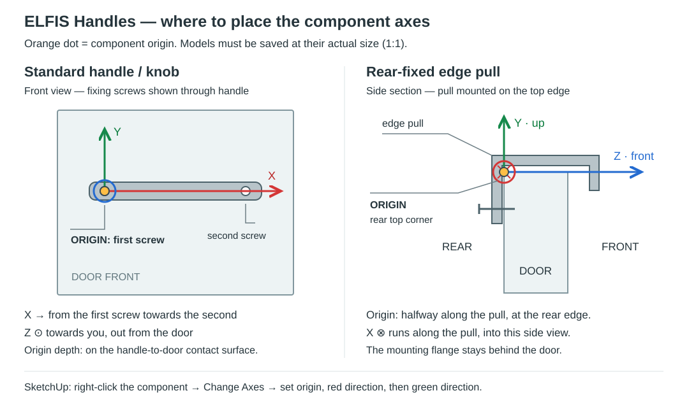

# ELFIS Handles 1.1.4-beta

> **BETA — Standard-handle import and placement have been revised. Calibrate fixing points and check placement on a test front before production use.**

An optional handle module for **ELFIS Door Studio 2.9.1**, with its own toolbar icon and installer. The Handles module remains beta. It uses Door Studio's front measurement and replacement routines; it is not a standalone extension.

[Download ELFIS Handles 1.1.4-beta](https://github.com/elfis/ELFIS-Door-Studio/raw/refs/heads/main/public/handles/1.1.4-beta/ELFIS_Handles_1.1.4-beta.rbz) · [Polska instrukcja](ELFIS_Handles_README.md)

## New in 1.1.4-beta

Move the red X to the end of the action row. All action buttons share a 36 px height; the X uses a compact symbol with a tooltip.

## New in 1.1.3-beta

The red **X** button starts click removal of ELFIS handles. It does not delete doors. A translated tooltip and accessible label explain the action.

## New in 1.1.2-beta — click removal

Choose the **red X** in the handle window, then click front components, including nested fronts. A red outline marks the target. Only ELFIS-marked handles are removed; unmarked fittings, the front and machining groups remain. Shared cabinet occurrences are isolated. Ctrl+Z undoes one removal; Esc exits. The source handle library is not required.

## Install

Install Door Studio first. In SketchUp, choose **Extensions → Extension Manager → Install Extension**, select `ELFIS_Handles_1.1.4-beta.rbz`, and restart SketchUp. Enable **View → Toolbars → ELFIS — Handles** if necessary. The same command is available in the Extensions menu.

## Import a handle

1. Open **ELFIS — Handles**, then click **Add .skp**.
2. Select your own handle model, prepared at its actual physical size.
3. Enter its name, type (`standard`, `knob` or `edge`), fixing pitch in mm, length, finish, supplier and product code.
4. Choose a position, orientation and offset, then click **Click fronts in model**.
5. Click front components, including components nested inside cabinets. Clicking an equipped front replaces its handle.

The library starts empty. Imported handles appear in the **Handle model dropdown**; this version does not have a thumbnail gallery. No manufacturer models are bundled.

## New in 1.1.1-beta

For standard handles, **tap Ctrl** to toggle horizontal at top centre / vertical at top right. **Tap Shift** to toggle top/bottom centre when horizontal, or top right/left when vertical. Release keeps the new position; holding a key does not cycle repeatedly. Offsets are retained. These explicit choices override the old position of an equipped front. Editing dialog settings or restarting the placement tool resets the shortcut position. Edge pulls keep their existing held-key shortcuts.

## New in 1.1.0-beta (previous behaviour)

- Changing position, orientation or offsets updates the active tool automatically, without pressing **Click fronts in model** again. Existing front geometry changes only after a placement or batch command.
- **Shift swaps left/right for standard handles**, preserving height and vertical/horizontal orientation. Releasing Shift restores the selected base position. Edge-pull shortcuts and mounting rules are unchanged.
- Side and top/bottom fixing offsets are independent. Explicit layout edits turn off preservation of an old placement; choosing a different model can still preserve per-front settings.
- The dialog shows fixing points, including the first screw, rather than centring a decorative bar on a placement point. Hovering a front supplies its actual dimensions and uses the same placement calculation as insertion.
- Standard-handle import starts mounting-point calibration. Existing library models can use **Set fixing points** without reimporting. Pick the first screw, the second screw, then the flat surface touching the door. For a knob the second point sets the red-axis direction. The pitch is measured from the selected points.
- The calibration sample is placed away from existing furniture. Orbit the view if needed to reach the contact face. On the last step the blue line should point from the door into the handle; **Tab** reverses it. **Cancel calibration** or **Esc with the model viewport focused** discards the temporary sample and restores the view. Do not change model geometry while calibrating.
- The original SKP and its axes are retained. Calibration is stored separately in the library and applied as a mounting transform. Uncalibrated legacy models still use their original axes.

## Legacy component axes

Save each prepared component as a separate SKP using the component's **Save As** command. Its file origin and axes must be the intended mounting frame.

- **Standard handle:** origin at one fixing screw, on the contact surface of the front. Local red X points to the second screw; local blue Z points outward from the front. Green Y follows SketchUp's right-handed coordinate system.
- **Knob:** origin at the fixing screw on the contact surface; pitch is zero.
- **Edge pull:** prepare for top-edge mounting. Origin is halfway along the pull at the intersection of the front's rear surface and top edge. Green Y points upward; blue Z points forward. Red X runs along the pull, completing the right-handed frame. The pull's physical cross-section must fit the door thickness; importing it does not reshape it.

## Position and offsets

Standard handles have eight positions and horizontal or vertical orientation. Corner offsets are measured from the adjacent edges to the nearest fixing screw. Centre positions account for half the pitch.

**Auto** uses half the cross-section width of recognised ELFIS framed fronts. Slab fronts, drawer variants and unknown frames use the configured offset, initially **45 mm**. **Custom** always uses the entered offset.

Edge pulls default to the centre of the top edge. Left/right mounting uses the distance from the door's top edge to the end of the pull. Top/bottom mounting has a separate shift right from centre. Rear-fixing placement uses the door's rear plane.

While clicking edge pulls: **Ctrl → right**, **Alt → left**, **Shift → bottom**. Without a modifier, the position selected in the window applies. A held modifier overrides preservation of an existing position. These shortcuts do not change the existing J-Pull door tool.

## Replace and order

- **Preserve existing front position and offsets** keeps each front's saved placement rules when changing models. Disable it to apply the current settings instead.
- **Apply to selected fronts** works on selected front components. For a selected cabinet, it finds nested fronts already fitted with handles.
- **Replace all existing handles** replaces handles added by this module throughout the model, including hidden occurrences. Exit the current group first. Unmarked, manually placed handles are not replaced.
- Each placement or batch replacement is one undo operation. Shared cabinet instances are isolated when editing one occurrence. Locked objects stop the operation.
- Changing a door style through ELFIS retains and re-seats the handle for the new thickness. Invalid fixing positions or a pull that cannot fit cause the replacement to roll back.
- The module's separate **Handle order list** consolidates models and finishes, counts nested occurrences, and copies a table including supplier and product code. Use **Refresh** after model edits. The existing door order table is unchanged.

## Library storage

`%APPDATA%\ELFIS\HandleLibrary\handles.json` stores product information and settings. The adjacent `models` folder stores copied SKP files. Back up the entire `HandleLibrary` directory. Removing an entry from the library leaves existing placed handles in the model.

## Limits and validation

This version does not create drilling operations. It targets rectangular front components, not arbitrary groups. Unknown frame widths cannot be inferred automatically. For an ordinary front, first click its actual front face so its outward direction can be identified.

Manually scaling a front also scales its nested handle. Reapplying the tool restores the handle's actual size; there is no automatic geometry-change observer in this version.

46 native geometry checks and 4 calibration-workflow checks passed in **SketchUp Pro 2026 on Windows**, using synthetic handle and cabinet fixtures. These covered screw offsets, pitch changes, point calibration, Shift placement, edge mounting, copied cabinets, batch replacement, thickness changes, scaling/mirroring, preview fixing points and order quantities. Browser checks also cover live settings, position buttons, translations and narrow layouts. Imported production models still require an axes and fit check. Other SketchUp versions and macOS have not been verified.

## License and support

Part of ELFIS Door Studio, distributed under the repository's [MIT License](LICENSE). Rights to any imported third-party models remain with their respective owners.

Optional [Ko-fi donations](https://ko-fi.com/elfis1920) support AI credits used for development and testing.

## Combined orders

Doors 2.9.3 also lists marked handles in the door order window and exports them in one PDF with fronts and end panels. Fully close and restart SketchUp after updating so new Ruby code is loaded.
