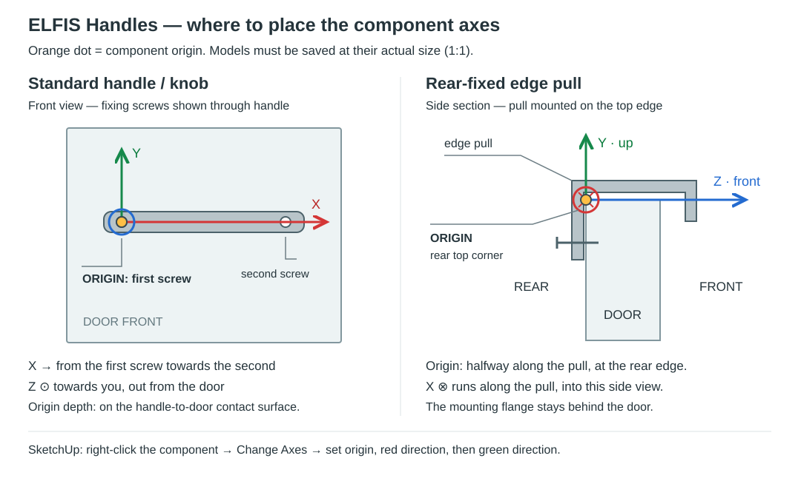

# ELFIS Handles 1.0.0 — wersja testowa

Osobny dodatek do ELFIS Door Studio 2.9.1, z własną ikoną i menu **Extensions → ELFIS — Handles**. Nie zmienia plików ani zapisanych profili biblioteki drzwi. W czasie działania rozszerza odczyt wymiarów i przenoszenie elementów, aby obsłużyć uchwyty.

## Instalacja

W SketchUp wybierz **Extensions → Extension Manager → Install Extension**, wskaż `ELFIS_Handles_1.0.0.rbz` i uruchom ponownie SketchUp. Pasek włączysz przez **View → Toolbars → ELFIS — Handles**.

## Dodawanie uchwytu

1. Otwórz ikonę **ELFIS — Handles**.
2. Kliknij **Add .skp / Dodaj .skp** i wskaż własny model. Biblioteka początkowo jest pusta.
3. Uzupełnij nazwę, rodzaj (`standard`, `knob`, `edge`), rozstaw śrub w mm, długość, wykończenie, producenta i kod produktu.
4. Ustaw pozycję na schemacie i odstępy, następnie wybierz **Click fronts in model / Klikaj fronty w modelu**.
5. Klikaj komponenty frontów, również wewnątrz szafek. Kliknięcie już wyposażonego frontu podmienia uchwyt.

Model jest kopiowany do `%APPDATA%\ELFIS\HandleLibrary\models`. Baza i ustawienia znajdują się w `handles.json` obok folderu `models`. Kopia całego tego katalogu stanowi kopię biblioteki.

## Osie modeli

Pomarańczowa kropka oznacza początek osi. Lewy rysunek: śruba uchwytu standardowego, na powierzchni styku z drzwiami. Prawy rysunek: przekrój z boku; początek na tylnej górnej krawędzi frontu, w połowie długości pochwytu. Kółko z kropką oznacza oś skierowaną do patrzącego, a kółko z krzyżykiem — w głąb rysunku.

Wczytywany plik SKP musi mieć osie montażowe i rzeczywiste wymiary 1:1. Własny komponent zapisz jako osobny plik przez polecenie komponentu **Save As**, zamiast zapisywać scenę z uchwytem daleko od początku układu.

- **Standard / gałka:** początek przy jednej śrubie, na powierzchni styku z frontem; czerwona X w stronę drugiej śruby, niebieska Z przed front. Zielona oś wynika z prawoskrętnego układu SketchUpa. Dla gałki rozstaw wynosi 0.
- **Edge / pochwyt:** model w pozycji montażu na górze; początek na tylnej górnej krawędzi frontu, w połowie długości pochwytu. Zielona Y ku górze drzwi, niebieska Z ku przodowi. Czerwona X przebiega wzdłuż pochwytu i wynika z prawoskrętnego układu. Pochwyt musi mieć przekrój pasujący do grubości frontu; sam import nie przebudowuje jego kształtu.

## Pozycje i odstępy

**Standard:** osiem pozycji, orientacja pionowa lub pozioma. Przy narożniku wartość odstępu mierzy się od obu sąsiednich krawędzi do osi najbliższej śruby. Przy środku krawędzi wtyczka uwzględnia połowę rozstawu, aby wyśrodkować cały rozstaw mocowań.

**Auto:** połowa szerokości przekroju rozpoznanego frontu Five-Piece / One-Piece. Płaskie fronty, warianty szuflad i nierozpoznane ramki używają wartości z pola odstępu, domyślnie 45 mm. Tryb **Custom / Własny** zawsze używa wpisanej wartości.

**Pochwyt:** góra i dół domyślnie na środku szerokości. Boczne pozycje używają odległości od góry do końca pochwytu. Góra/dół mają osobne przesunięcie w prawo od środka. Mocowanie odnosi się do tylnej powierzchni drzwi.

Podczas klikania pochwytu: **Ctrl — prawa, Alt — lewa, Shift — dół**. Bez klawisza obowiązuje pozycja wybrana w oknie; początkowo góra. Przytrzymany skrót ma pierwszeństwo przed zachowaniem starej pozycji. Nie zmienia to skrótów J-Pull w narzędziu drzwi.

## Podmiana i zestawienie

- **Preserve existing… / Zachowaj…** domyślnie zachowuje pozycję, orientację i odstępy poprzedniego uchwytu. Wyłączenie stosuje bieżące ustawienia.
- **Apply to selected fronts** obsługuje zaznaczone komponenty frontów, a w zaznaczonych szafkach odnajduje fronty już wyposażone w uchwyty.
- **Replace all existing handles** podmienia uchwyty dodane przez ten dodatek w całym modelu, również w ukrytych elementach. Należy wyjść z edycji grupy. Nie podmienia przypadkowych, wcześniej ręcznie wstawionych modeli.
- Zmiana ma pojedynczą operację cofania. Powielone szafki są izolowane podczas edycji konkretnej kopii. Zablokowane obiekty powodują przerwanie operacji.
- Zmiana stylu frontu w ELFIS zachowuje uchwyt i osadza go względem nowej grubości. Niepasujący rozstaw lub pochwyt powoduje wycofanie podmiany z komunikatem.
- **Handle order list / Lista uchwytów** w oknie dodatku grupuje modele i wykończenia, zlicza zagnieżdżone wystąpienia. **Refresh** odświeża, **Copy table** kopiuje tabelę z producentem i kodem. To osobne zestawienie uchwytów; istniejąca tabela zamówień frontów pozostaje bez zmian.

## Ograniczenia tej wersji

Dodatek nie generuje wierceń. Biblioteka nie zawiera modeli producentów. Obsługiwane są prostokątne komponenty frontów; kliknięcie grupy nie zastępuje wskazania komponentu frontu. Nie rozpoznaje dowolnych ramek spoza ELFIS ani kierunku przodu surowych modeli na podstawie ich nazwy. Przy pierwszym montażu na zwykłym froncie najlepiej kliknąć jego przednią powierzchnię. Samodzielne skalowanie frontu po wstawieniu uchwytu skaluje również zagnieżdżony uchwyt — ponowne zastosowanie narzędzia przywraca jego rzeczywisty rozmiar. Nie dodano obserwatora automatycznej korekty po ręcznej edycji geometrii.

Przetestowano w SketchUp Pro 2026 na Windows na syntetycznych modelach. Własne modele uchwytów wymagają sprawdzenia osi i dopasowania do frontów.
